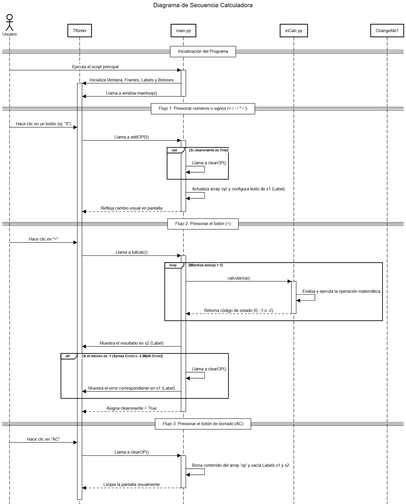
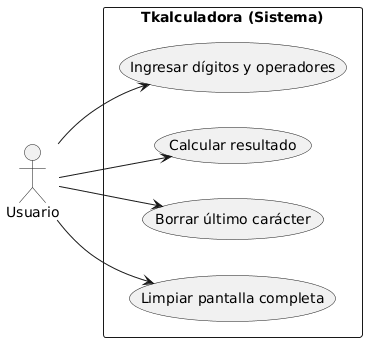

# Calculadora en TKinter
## Uso
```
python3 main.py
```

## Diagramas
### Diagrama de secuencia

### Diagrama de casos


## Características
1. Guarda los caracteres en una "pila", similar a las calculadoras físicas
1. Respeta la jerarquía de operaciones (primero * y /, luego + y -)
1. Syntax Error y Math Error
